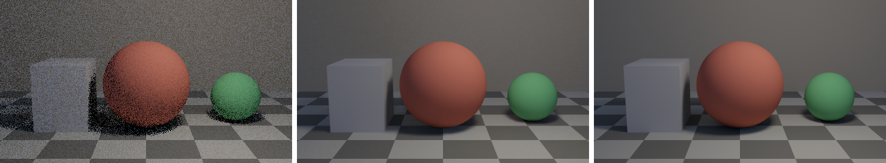

# metalfx_denoiser

Apple's MetalFX denoiser (`MTLFXTemporalDenoisedScaler`, MetalFX's ray reconstruction) driven from
Rust on top of [wgpu](https://wgpu.rs)'s Metal backend.

[`bevy_solari`](https://github.com/bevyengine/bevy/tree/main/crates/bevy_solari) runs on macOS but
has no denoiser there. On other platforms it uses DLSS Ray Reconstruction through `dlss_wgpu`. This
crate is a prototype of the same thing for Macs: it denoises (and optionally upscales) a noisy
path-traced frame from wgpu textures, using the guide-buffer formats Solari already produces.



*Left to right: 1 sample per pixel input, MetalFX output, 1024-spp reference. From the headless
harness after 200 frames with a static camera.*

> **Status:** prototype. The API may change, and the crate isn't on crates.io. A Bevy integration
> (a `metalfx` feature in `bevy_anti_alias` plus Solari guide-buffer changes) works locally and
> will be proposed upstream separately.

## Requirements

- Apple silicon Mac (aarch64). Tested on an M2 Pro.
- macOS 26 or newer. `MTLFXTemporalDenoisedScaler` doesn't exist on older systems.
- A recent stable Rust toolchain (the crate uses edition 2024).

On anything else, `MetalFxDenoiser::new` returns an error instead of panicking.

## Demo

### 1. Run the tests

```sh
cargo test --release
```

These create a denoiser on your GPU and check, among other things, that it reports support, rejects
mismatched textures and out-of-range scales, round-trips the camera matrices, and denoises a
constant-color image to (almost) the same color.

### 2. Run the harness

The harness renders a small path-traced scene in a wgpu compute shader (ground plane, back wall,
two spheres, a box and a spherical area light). Every frame it produces 1-spp noisy color plus the
guide buffers MetalFX needs (depth, motion vectors, albedo, normals, roughness), all with the same
formats and conventions as Bevy and Solari. It denoises each frame and compares the result with a
high-spp reference and with a simple reprojecting moving average ("EMA") as a baseline.

```sh
MTL_DEBUG_LAYER=1 cargo run --release --example harness
```

It takes about 20 seconds. The camera follows a fixed script over 600 frames:

| Frames | Phase | What it tests |
|---|---|---|
| 0–59 | Warmup | History building up |
| 60–199 | Static | Denoising quality with full history |
| 200–399 | Pan | Motion vectors and jitter: history has to be reprojected |
| 400 | Cut | Hard camera cut with history reset: nothing from before the cut may bleed in |
| 401–429 | Recovery | History rebuilding after the cut |
| 430–599 | StaticAfterCut | Static again, new viewpoint |

Output on an M2 Pro (RMSE against the reference after Reinhard tonemapping, lower is better):

```
adapter: Apple M2 Pro

600 frames in 19.0s, outputs in target/harness/default
MetalFX GPU time [960, 540] -> [960, 540]: median 4.16 ms, p95 5.99 ms, min 4.08 ms (540 frames)
phase               noisy   denoised      ema
Cut                0.0343     0.0141   0.0343
Pan                0.0336     0.0090   0.0429
Recovery           0.0351     0.0122   0.0183
Static             0.0336     0.0088   0.0083
StaticAfterCut     0.0349     0.0111   0.0087
Warmup             0.0334     0.0096   0.0135

success metrics (1:1):
  [PASS] #2 static: noisy/denoised = 3.82 (>= 3.75)
  [PASS] #3 pan: denoised 0.0090 < ema 0.0429
  [PASS] #4 cut: no ghosting, denoised/noisy = 0.41 (<= 1.5)
```

How to read it:

- **Static:** MetalFX cuts the error by about 3.8×. The EMA is about as good here, because a
  static camera is the easy case for plain accumulation.
- **Pan:** MetalFX stays clean (0.0090) while the EMA smears (0.0429). This is the case that shows
  the motion vectors and jitter are passed correctly.
- **Cut:** the first frame after the cut is far below the noisy input's error, so no old content
  ghosts in.
- `MTL_DEBUG_LAYER=1` turns on Metal API validation. A clean run prints no validation messages.

Images and per-frame numbers go to `target/harness/<name>/`:

- `NNNN_noisy.png`, `NNNN_denoised.png`, `NNNN_ema.png`, `NNNN_reference.png` at frames 199 (end of
  static), 300 (mid-pan), 399/400/401/410 (around the cut) and 599
- `metrics.csv`: frame, phase, and noisy/denoised/EMA RMSE every 10 frames

Compare `0300_ema.png` with `0300_denoised.png` to see the pan difference, and `0400_*` for the cut.

### 3. Try other settings

Run `cargo run --release --example harness -- --help` for every option. Use `--name` to keep runs in
separate output folders. Some worth trying:

```sh
# Upscale 960x540 -> 1920x1080 while denoising (cheaper than denoising at 1080p)
cargo run --release --example harness -- --input 960x540 --output 1920x1080 --name upscale

# Moving light: MetalFX still beats the EMA, but shadows visibly lag behind the light
cargo run --release --example harness -- --moving-light --name moving_light

# Wrong motion vector sign: pan quality drops (0.0090 -> about 0.016)
cargo run --release --example harness -- --mv-sign 1 --name mv_wrong

# Reset history every frame: static quality drops, which shows the reset flag is honored
cargo run --release --example harness -- --reset-every 1 --name reset_every
```

The success checks are only printed when input and output sizes match. With upscaling, the noisy and
EMA columns show `NaN` and only denoised and reference images are written, because the noisy input
is at a lower resolution than the reference. The upscaling run takes about a minute.

### 4. Check resizes for leaks

Bevy recreates the denoiser whenever the window is resized. This example cycles through 720p,
1080p and 540p → 1080p, encoding a few frames at each size:

```sh
cargo build --release --example resize
leaks --atExit -- target/release/examples/resize 30
```

It should report 0 leaks, and the resident memory printed after each cycle should stay flat.

## Using the crate

```rust
use metalfx_denoiser::{DenoiserDescriptor, DenoiserParams, DenoiserTextures, MetalFxDenoiser};

// Formats matching Solari's guide buffers and Bevy's HDR view target.
let desc = DenoiserDescriptor::solari([1280, 720], [1920, 1080]);
let mut denoiser = MetalFxDenoiser::new(&device, desc)?;

// Create your textures with at least these usages.
let usages = denoiser.required_usages();

// Every frame:
let command_buffer = denoiser.encode(
    &device,
    DenoiserTextures {
        color: &noisy_color,
        depth: &depth,
        motion: &motion_vectors,
        diffuse_albedo: &diffuse_albedo,
        specular_albedo: &specular_albedo,
        normal: &world_normals,
        roughness: &roughness,
        output: &output,
    },
    &DenoiserParams {
        jitter_offset: (-jitter).into(),            // pixels, negated like DLSS-RR
        motion_vector_scale: (-render_size).into(), // render (input) resolution, negated
        reset: camera_cut,
        ..Default::default()
    },
)?;
queue.submit([command_buffer]);
```

`MetalFxDenoiser::support(&device)` reports whether the device supports it and the allowed
input-to-output scale range (1×–3× on an M2 Pro). MetalFX work goes into its own command buffer and
is never mixed into an encoder that also carries wgpu commands.

Inputs may be larger than the render size: the top-left region is used. This matches how Bevy
renders into part of a full-size view target when the render resolution is lowered. The output must
be exactly the output size.

## Conventions

Found by experiment with the harness, using matrices, jitter and motion vectors built exactly the
way Bevy builds them:

| Parameter | Value |
|---|---|
| `motion_vector_scale` | `-render_resolution` (input size, not output size), same as DLSS-RR |
| `jitter_offset` | `-TemporalJitter::offset`, in pixels, same as DLSS-RR |
| Normals | World space, as Solari writes them (view space is no better) |
| `depth_reversed` | `true` (Bevy's reverse-Z) |
| `reset` | Honored. MetalFX also discards invalid history at cuts on its own. |
| Camera matrices | Set them, but they currently have no measurable effect (see below) |

## Known limitations

- **aarch64 only.** MetalFX's camera matrix properties use `simd_float4x4`, which clang passes in
  vector registers. Stable Rust can't express that calling convention, so the setters call
  `objc_msgSend` through inline assembly, after checking the method's runtime type encoding.
- **The camera matrices have no measurable effect** in the test scene. They may only matter for
  reprojecting specular reflections together with specular hit distance, which isn't wired up yet.
- **Roughness is untested.** The test scene is matte only, so whether MetalFX wants perceptual or
  linear roughness is still open.
- **Not wired up yet:** specular hit distance, reactive mask, denoise strength mask, transparency
  overlay, an exposure texture, and the Metal 4 (`MTL4FXTemporalDenoisedScaler`) path.
- **Cost:** on an M2 Pro, about 17 ms at 1080p native, 8.6 ms for 720p → 1080p, and 4.2 ms at 540p
  native. Cost scales with the input resolution, so rendering at a lower resolution and letting
  MetalFX upscale is probably the practical setup.

## License

Licensed under either of

- Apache License, Version 2.0 ([LICENSE-APACHE](LICENSE-APACHE))
- MIT license ([LICENSE-MIT](LICENSE-MIT))

at your option.
